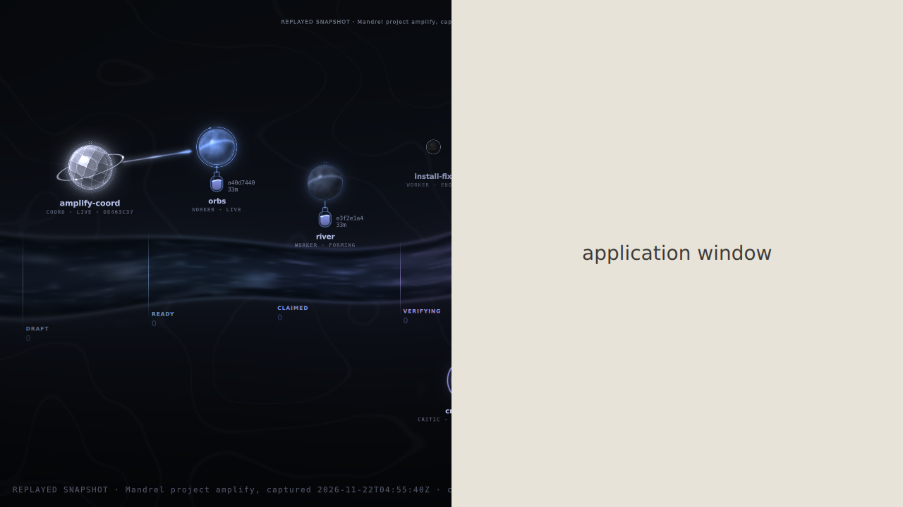
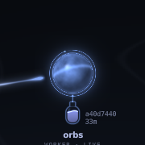

# P0 spike: plugin skeleton and shader pipeline

Punch `a15523ac` · orb `shell-spike` · Git branch `foreman/a15523ac-shell`

## Answer: the plugin path works; the fallback is not needed

A third-party Omarchy shell plugin **may** open its own `PanelWindow` on
`WlrLayer.Bottom`, run `Process`, and use `XMLHttpRequest`. From the Omarchy
source (basecamp/omarchy, branch `quattro`):

- `shell/shell.qml` `ensureService()` loads a third-party `service` entry point with
  `Qt.createComponent(url)` in the same QML engine as `omarchy-shell`, then
  `createObject(null)`: third-party services get no visual parent, so all UI has to be
  top-level windows, which is what Amplify wants anyway.
- The "capability-scoped facades" are only the *host objects* injected as properties
  (`shell`, `manifest`, `pluginRegistry`, `barWidgetRegistry`). QML imports are
  engine-wide, so `import Quickshell.Wayland` (`PanelWindow`, `WlrLayershell.layer`),
  `import Quickshell.Io` (`Process`, `FileView`, `IpcHandler`) and the JS
  `XMLHttpRequest` global all resolve. `docs/omarchy-shell.md`: the facades are
  "API boundaries, not same-process QML sandboxes … Plugin code also has the same
  user-level file and process access as the shell."
- `bin/omarchy-plugin-validate` checks only schemaVersion, required fields, the id
  (not `omarchy.*`), entry-point paths and symlinks. It does not scan imports.
  `omarchy-plugin-validate plugin/` exits 0 on this branch.
- The built-in `shell/plugins/background/Background.qml` (L567-582) already uses a
  `Variants { model: Quickshell.screens; PanelWindow { WlrLayershell.layer: WlrLayer.Bottom } }`,
  the same pattern this plugin uses.

Caveats for later phases:
- Do not import `qs.Commons` / `qs.Ui`. They resolve against the shell root, not
  `~/.config/omarchy/plugins/<id>`. The plugin reads the palette itself from
  `~/.local/state/omarchy/current/theme/colors.toml`.
- `omarchy plugin add <url>` wants `manifest.json` at the **repo root**. This repo keeps
  it in `plugin/`, so the spike installs with a directory link
  (`tools/install-plugin.sh`). Shipping via `plugin add` later needs a release repo or
  a subtree split whose root is `plugin/`.
- A plugin is unsandboxed code inside the long-lived shell. A QML error or a busy JS
  loop in Amplify affects the whole desktop. The fallback below isolates it if that
  ever matters.

The fallback still ships because it reuses the same QML and costs nothing:
`plugin/shell.qml` lets `quickshell -p plugin/` run the identical `Service.qml`, and
`tools/fallback/install.sh` installs `amplify.service` (systemd user unit) plus a
`~/.config/omarchy/hooks/theme-set.d/amplify` hook. Use it only if the plugin path
misbehaves on real hardware.

## What was built

| Path | What |
| --- | --- |
| `plugin/manifest.json` | `ridgetopai.amplify`, kind `service`, entry `Service.qml` |
| `plugin/Service.qml` | One `PanelWindow` per screen (`Variants` over `Quickshell.screens`) on `WlrLayer.Bottom`, `ExclusionMode.Ignore`, no keyboard focus; `mask: Region` built from the orbs' hit circles; palette via `Process` (`cat colors.toml`) re-run by a `FileView` watch; `IpcHandler` target `amplify` (`refreshTheme`); optional `XMLHttpRequest` probe (`AMPLIFY_PROBE_URL`); optional fps log (`AMPLIFY_FPS=1`) |
| `plugin/Orb.qml` | `ShaderEffect` with `fragmentShader: shaders/orb.frag.qsb` + circular `MouseArea` |
| `plugin/shell.qml` | Standalone entry for `quickshell -p plugin/` |
| `shaders/orb.frag` | Qt 6 GLSL 440 placeholder Meridian orb: lit sphere, surface noise, rotating meridian, pulse ring, halo; uniforms `time`, `energy`, `core`, `halo` |
| `plugin/shaders/orb.frag.qsb` | Compiled by `tools/build-shaders.sh` (qsb → GLSL 100es/120/150/300es, HLSL 50, MSL 12). Committed because `omarchy plugin add` runs no build step |
| `tools/headless-shot.sh` | Headless render + 6 checks (below); writes `docs/spike/headless.png`, `docs/spike/orb.png` |
| `tools/harness/` | Stand-in desktop: wallpaper on `WlrLayer.Background` that logs clicks, an app window over the right half, a fixture palette |
| `tools/install-plugin.sh` | Primary install into omarchy-shell (link, rescan, wait until listed, enable; `--remove`) |
| `tools/test-install-plugin.sh` | Installer test against stub `omarchy`/`omarchy-shell` with a delayed rescan |
| `tools/fallback/` | systemd user unit, theme-set hook, installer (`--remove`) |

## Headless proof (this orb)

Environment: Debian 13 orb without a GPU or `/dev/dri`, using Nix packages:
Quickshell 0.3.2, qsb 6.12.0, sway 1.12 (`WLR_BACKENDS=headless`,
`WLR_RENDERER=pixman`), Mesa 26.3.1 llvmpipe (OpenGL 4.6) for Qt, grim, wayvnc
and vncdotool for pointer input, and ImageMagick. Pointer input goes through
wayvnc because one-shot `wlrctl` adds and removes a virtual pointer on every
call, and Qt never binds `wl_pointer` in time to see the click.

```
HEADLESS_MESA=/nix/store/…-mesa-26.3.1 tools/headless-shot.sh   # exit 0
log: amplify: ready layer=bottom screen=HEADLESS-1 size=1280x720 shader=compiled
PASS layer is bottom
PASS shader compiled from .qsb
PASS uncovered orb renders (accent-lit)                       pixel 142 189 255
PASS app window covers the orb (layer below windows)          pixel 232 227 216
PASS click on orb reaches the orb                             "amplify: orb click meridian"
PASS click on empty desktop passes through the mask           "harness: wallpaper click 600,660"
```





Mutations, each run on a copy of the tree:

| Mutation | Result |
| --- | --- |
| Drop the `.qsb` build step from `headless-shot.sh` | RED, 2 checks: shader not compiled, orb not rendered |
| `WlrLayer.Bottom` → `WlrLayer.Top` in `Service.qml` | RED, 2 checks: log says top, and the orb is drawn over the app window (`mutation-layer-top.png`; the ambient orb's core reads 150 199 255 against the 220 red threshold) |
| Remove the `mask: Region` | RED, 1 check: the empty-desktop click is swallowed |
| Unmutated control | GREEN, exit 0 |

Install race (attempt 2): on real Omarchy, `omarchy-shell shell rescanPlugins`
returns as soon as the scan starts, so an immediate `omarchy plugin enable` answered
"not known". `tools/install-plugin.sh` now polls `omarchy plugin list --json` for the
id every 0.2 s, for up to 10 s, and exits non-zero with a message on timeout before it
enables. `tools/test-install-plugin.sh` runs the installer against stub `omarchy`,
`omarchy-shell` and `qsb` commands where the id appears 1 s after the rescan (or
never). It exits 0 with 6/6 PASS on the fixed script. On the old script it fails
4 checks with the same "not known" error Brian saw.

Extra runtime probe (scratch, not committed): `XMLHttpRequest` GET returned
`status=200`; editing the theme's `colors.toml` re-ran the `Process` and changed the
accent to `#ff5500`; `quickshell ipc -p plugin call amplify refreshTheme ""` returned
`ok`; the fps log read 60.0 to 60.2 on llvmpipe.

The headless run proves layering, input masking, the shader pipeline and the
plugin's QML. It does **not** prove that `omarchy-shell` loads the plugin, because
there is no Omarchy here. The loader reading above is the evidence for that, and
Brian's check below confirms it.

## Brian: 3-command check on Omarchy

```bash
git clone -b foreman/a15523ac-shell https://github.com/RidgetopAi/amplify ~/src/amplify && cd ~/src/amplify
tools/install-plugin.sh        # builds .qsb (needs qt6-shadertools: sudo pacman -S qt6-shadertools), validates, links, waits out the reload the link triggers and for the shell to list it, enables
omarchy plugin list | grep amplify && journalctl --user -b | grep -i amplify | tail
```

Already installed from the first attempt (plugin listed but disabled)? Pick up the fix with
`cd ~/src/amplify && git pull && tools/install-plugin.sh`.

Expected: two orbs on every monitor, above the wallpaper and below every window.
Clicking an orb's centre logs `amplify: orb click meridian`. Double-clicking empty
desktop still opens Omarchy's background picker, because the mask passes it
through. Changing the theme (`omarchy-theme-set <name>`) recolours the orbs within
a second. Remove with `tools/install-plugin.sh --remove`. If the shell logs
anything else, try the fallback: `tools/install-plugin.sh --remove && tools/fallback/install.sh`.

If `qt6-shadertools` is not installed, `install-plugin.sh` stops at the build step.
The committed `.qsb` (qsb 6.12, serialization version 9) should load on any current
Arch Qt 6, so you can also link it by hand:
`ln -s ~/src/amplify/plugin ~/.config/omarchy/plugins/ridgetopai.amplify && omarchy-shell shell rescanPlugins && omarchy plugin enable ridgetopai.amplify`.

## Brian: what to measure on your GPU

llvmpipe numbers mean nothing for this, so these must come from your machine. Set
`AMPLIFY_FPS=1` in the shell's environment, or run the fallback with
`AMPLIFY_FPS=1 quickshell -p plugin/` after removing the plugin, and read
`amplify: fps` lines. For CPU, use `top -p $(pgrep -f omarchy-shell)` (or
`pgrep quickshell` in the fallback), and for GPU use `nvtop`/`radeontop`/`intel_gpu_top`:

1. **fps idle**: empty workspace, orbs visible, 60 s. Expect your refresh rate.
   Record shell CPU % and GPU %.
2. **fps busy**: drag a window across the orbs and play a video in another window.
   Does fps stay at refresh, and does it stutter the video?
3. **fps focus**: the Meridian (focus) orb at full size on your largest or HiDPI
   monitor. Record GPU % against idle. The shader costs per pixel, so this is the
   worst case for one orb.
4. **CPU when covered**: a fullscreen or tiled window covering every orb for 60 s.
   Record shell CPU %. A Bottom-layer surface keeps animating under windows; if CPU or
   GPU stays above about 1 %, P1 must pause the animation when covered (Hyprland
   `activewindow`/fullscreen events or the frame-callback rate).
5. **Baseline**: the same four readings with the plugin disabled, so the delta is
   Amplify's cost alone.

## Reproduce headless (any Linux with Nix)

```bash
nix profile install nixpkgs#quickshell nixpkgs#qt6.qtshadertools nixpkgs#sway nixpkgs#grim nixpkgs#wayvnc nixpkgs#python3Packages.vncdotool nixpkgs#imagemagick
HEADLESS_MESA=$(nix build --no-link --print-out-paths nixpkgs#mesa) tools/headless-shot.sh
```
